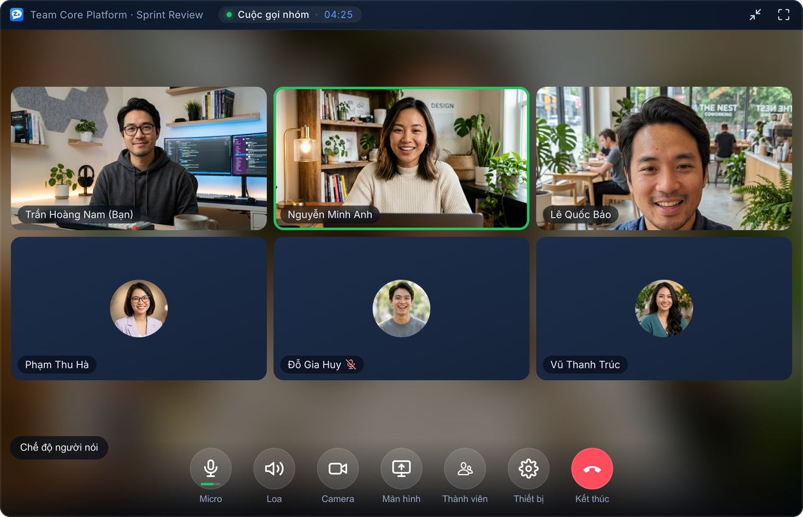
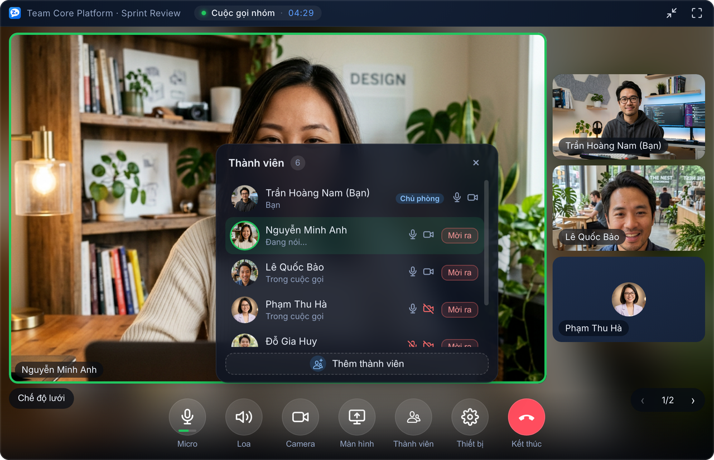
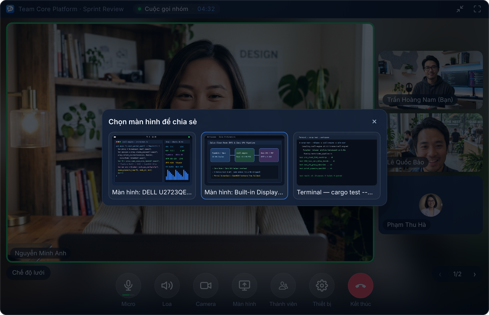
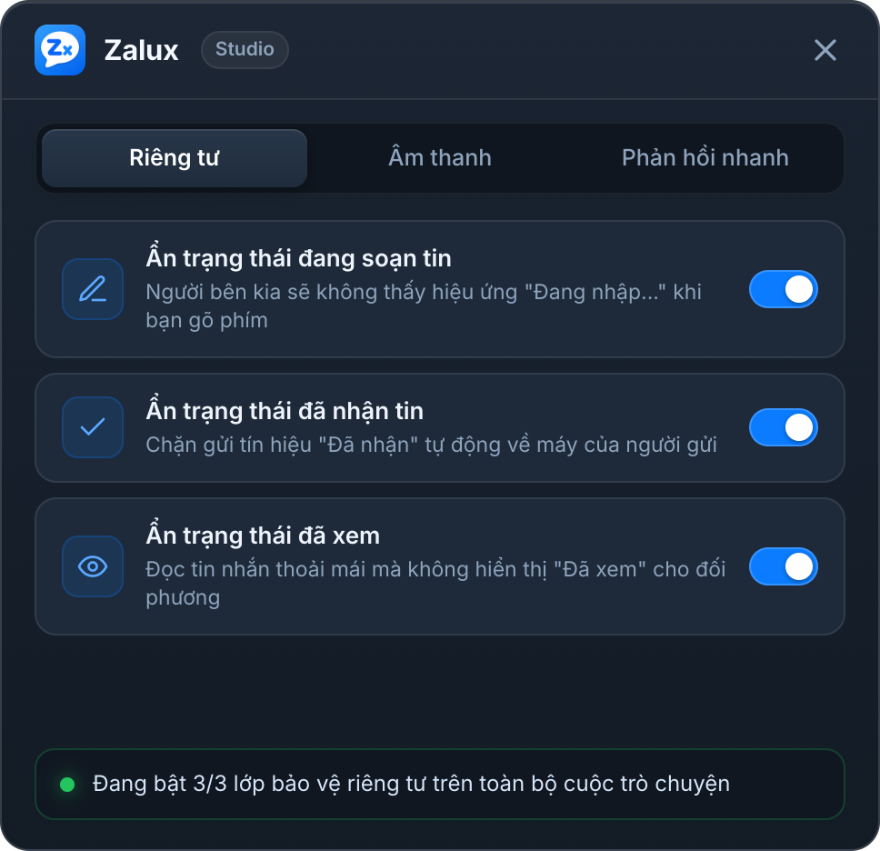
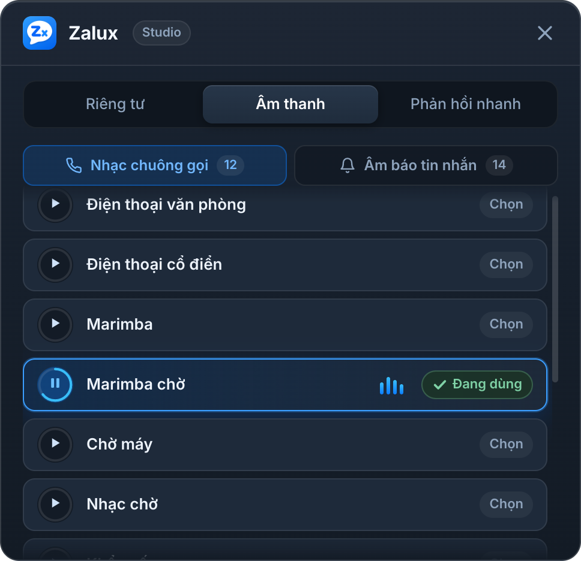

<div align="center">


# Zalux

**Zalo trên Linux — mượt, native, không Wine.**

`Zalo` + `Linux` = `Zalux`

[](LICENSE)
[](#môi-trường-đã-kiểm-thử)
[](VERSION)
[](#hiệu-năng-rust--tài-nguyên-thực-tế)
[](https://todo-laterx.github.io/zalux/)

<sub>Unofficial Zalo desktop for Linux. Official macOS client UI powered by an independent, in-house Rust VoIP/SFU Call Engine &amp; 9 Linux N-API native modules.</sub>

</div>

## Giới thiệu

**Zalux** đưa giao diện client Zalo macOS chính thức chạy trực tiếp trên Linux Electron kết hợp cùng **Call Engine 1:1 / Nhóm và 9 module hệ thống viết mới hoàn toàn từ đầu bằng Rust (`zcall-engine`, `zalo-asar` và 9 N-API `.node` addons)**.

> **Kiến trúc Độc lập (100% In-House Clean-Room):** Toàn bộ tầng xử lý cuộc gọi 1:1 & nhóm (`zcall-engine`), chia sẻ màn hình `PipeWire`/`OpenH264`, trình đóng gói `zalo-asar`, 9 thư viện `.node` biên dịch cho Linux, bộ công cụ vá bundle Python và giao diện `plugins/{zcall,zalux}` đều được tự thiết kế và viết riêng từ đầu — **hoàn toàn không phụ thuộc, không kế thừa và không sử dụng bất kỳ mã nguồn/userscript MIT của dự án cộng đồng bên thứ ba nào**.

---

## Hệ thống Gọi Thoại, Video 1:1 HD & Họp Nhóm Zavi SFU

<p align="center">
  
</p>

<table>
  <tr>
    <td width="50%" align="center">
      <br>
      <sub><b>Gọi Video 1:1 HD 720p @ 24fps</b> — Nền mờ đồng bộ khung hình, PiP hai chiều &amp; đo mức micro thời gian thực</sub>
    </td>
    <td width="50%" align="center">
      <br>
      <sub><b>Họp Nhóm Zavi SFU (Chế độ Lưới)</b> — Tự khớp khung hình ngang/dọc từng người &amp; viền xanh người đang nói</sub>
    </td>
  </tr>
  <tr>
    <td width="50%" align="center">
      <br>
      <sub><b>Chế độ Người nói (Speaker View)</b> — Phân trang tự động, quản lý phòng &amp; mời thêm bạn ngay trong cuộc gọi</sub>
    </td>
    <td width="50%" align="center">
      <br>
      <sub><b>Chia sẻ màn hình Đa màn hình</b> — Portal PipeWire + OpenH264 native kèm hộp chọn màn hình/cửa sổ trực quan</sub>
    </td>
  </tr>
</table>

---

## Kiến trúc & Cải tiến Kỹ thuật

1. **Rust ZRTC 1:1 & Zavi SFU Group Call Engine (`zcall-engine`)**:
   - Xử lý trực tiếp giao thức báo hiệu 1:1 & hội nghị nhóm Zavi SFU, bắt tay Relay/P2P, mã hoá SRTP hai chiều, RTCP TWCC/SR/PLI và thu phát âm thanh Opus 16 kHz qua `PipeWire`/`PulseAudio`.
   - **Video 1:1 HD & Đa Codec**: Luồng gửi (`tx`) mã hoá `1280×720 @ 24fps` (`1.2 Mbps`), đóng gói ZRTC `1140` byte/mảnh (`PT 98` Keyframe / `PT 97` Delta), tự động khôi phục camera & `VideoEncoder` khi gián đoạn; luồng nhận (`rcv`) giải mã độ trễ 0 khung hình cả **H.264 (`PT 97/98`)** lẫn **HEVC (`PT 121/122`)** qua `libavcodec` (`low_delay`).
   - **Họp Nhóm Kiểu Zoom**: Chuyển đổi mượt giữa **Chế độ Lưới (`Gallery`)** và **Người nói (`Speaker View`)**, ghim người nói, tự khớp tỉ lệ khung hình riêng (camera PC `16:9` đi cùng điện thoại dọc `9:16` không biến dạng), phân trang khi đông người, xem danh sách thành viên và mời thêm bạn trực tiếp vào phòng.
   - **Chia sẻ màn hình Native Linux**: Tích hợp `xdg-desktop-portal` ScreenCast + `PipeWire` (`MemFd`) + mã hoá `OpenH264` (`1.5 Mbps @ 15fps`) chạy trên luồng riêng trong Rust (không cần GPU encoder), tự động chuyển tiếp mượt về hộp chọn đa màn hình có ảnh xem trước khi cần.
   - **Điều khiển thiết bị thông minh**: Thanh trượt chỉnh âm lượng micro trực tiếp, tự lọc bỏ thiết bị âm thanh ảo và camera hồng ngoại (IR), hỗ trợ nhận cuộc gọi video tắt sẵn camera (`camStartOff`).
2. **9 Module Native N-API bằng Rust (`runtime/nativelibs/`)**:
   - Thay thế toàn bộ addon gốc của macOS bằng bản biên dịch ELF64 Linux `x86_64` tối ưu: `node_sqlite3` (tích hợp tĩnh `libsqlite3` + FTS3/FTS5/RTree/WAL), `db-cross-v4` (giải mã AES + LZMA/zstd cho đồng bộ lịch sử đa thiết bị), `zjxl` (giải mã/mã hoá ảnh JPEG XL), `zimage`, `mp4thumb`, `file-utils`, `file-utilities`, `zwalker` (quét & dọn dung lượng dữ liệu), `zlang` (nhận diện ngôn ngữ tin nhắn).
3. **Tích hợp Sâu Môi trường Desktop Linux**:
   - **System Tray & Unread Badge**: Khay hệ thống hiển thị số tin nhắn chưa đọc thời gian thực, đồng bộ huy hiệu với Dock/Taskbar (`zalux.desktop`).
   - **XWayland / Wayland & Dark Frame Sync**: Tự động ưu tiên XWayland ổn định cho định vị cửa sổ và khay hệ thống trên GNOME/KDE (hỗ trợ `--wayland` khi muốn chạy Wayland thuần), đồng bộ viền cửa sổ tối (`_GTK_THEME_VARIANT=dark`) và dán ảnh/tệp trực tiếp qua `wl-paste` / `xclip`.
4. **Bảng điều khiển Zalux (Quyền riêng tư & Âm thanh)**:
   - Tích hợp ngay trên thanh điều hướng trái (`Ctrl+Shift+P`): chủ động bật/tắt ẩn trạng thái **“đang soạn tin”**, **“đã nhận”**, **“đã xem”** (chặn trực tiếp trên máy trước khi gửi lên máy chủ); nghe thử và đổi tức thì **12 nhạc chuông cuộc gọi** cùng **14 âm thông báo tin nhắn**.

---

## Hiệu năng Rust & Tài nguyên Thực tế

Việc viết mới toàn bộ Call Engine và 9 thư viện hệ thống bằng **Rust** giúp loại bỏ hoàn toàn ứng dụng phụ `ZaloHelper.app / ZaloCall` (C++ / Qt5 Widgets + Multimedia nặng nề trên macOS/Windows) cũng như tránh lớp dịch Wine tốn kém trên Linux.

Dưới đây là số liệu đo đạc thực tế qua `/proc/<pid>/smaps_rollup` trên phiên làm việc thực (Ubuntu Wayland/XWayland, đã tải cơ sở dữ liệu lịch sử chat lớn):

| Thành phần | Bản gốc (macOS/Windows) hoặc chạy qua Wine | Zalux trên Linux (Native Rust) |
|---|---|---|
| **Daemon Call Engine chạy nền (`idle`)** | `ZaloCall` C++/Qt5: **~80 – 150 MB RSS** | `zcall-engine` (Rust thuần, không GUI runtime): **~3.4 MB PSS** (~5.8 MB RSS) |
| **Giải mã Video H.264/HEVC trực tiếp** | Phụ thuộc tiến trình phụ nặng | `zcall-engine --decode-pipe`: **~6.0 MB PSS** (~12.0 MB RSS, độ trễ 0 frame) |
| **Bộ 9 thư viện Native N-API (`.node`)** | Nhiều dynamic library + framework rời | **~15.4 MB** tổng dung lượng trên đĩa sau khi `strip`, chạy in-process không GC pause |
| **Tổng RAM toàn ứng dụng khi mở nhiều DB chat** | ~650 – 950 MB (+ **300 – 500 MB** nếu chạy qua Wine) | **~788 MB PSS** tổng cộng — trong đó Electron/Chromium + Zalo React UI chiếm **~778 MB PSS (~98.8%)**, toàn bộ tầng Rust của Zalux chỉ chiếm **< 1.2% (~3.4 – 9.4 MB PSS)** |

> **Góc nhìn kỹ thuật trung thực:** Phần lớn RAM của ứng dụng đến từ nhân Electron/Chromium và bundle giao diện web của Zalo (~778 MB PSS khi mở nhiều cuộc trò chuyện lớn). Lợi thế cốt lõi của Rust trong Zalux nằm ở việc giữ cho **toàn bộ hệ thống gọi thoại/video/nhóm, chia sẻ màn hình PipeWire và 9 module I/O, SQLite, mã hoá chạy native trực tiếp trên Linux chỉ với vài MB bộ nhớ**, không rò rỉ RAM khi treo máy cả ngày và không kéo theo bất kỳ runtime phụ nào.

---

## Môi trường đã kiểm thử

| Bản phân phối | Nhắn tin / Đồng bộ / Media | Gọi 1:1 · Gọi Nhóm · Share Màn hình | Ghi chú |
|---|---|---|---|
| **Ubuntu 26.04 / 24.04** | Đã kiểm thử | Voice · Video HD · Group SFU · PipeWire | GNOME Wayland (XWayland) & X11 |
| **Debian 12 / 13** | Tương thích | Tương thích | AppImage / `.deb` |
| **Fedora / RHEL** | Tương thích | Tương thích | AppImage / `.rpm` (`pipewire-libs`) |
| **Arch Linux** | Tương thích | Tương thích | AppImage / `PKGBUILD` (`libpipewire`) |

---

## Cài đặt

### Cách 1: Cài nhanh một dòng lệnh (không cần quyền root)

```bash
curl -fsSL https://raw.githubusercontent.com/todo-laterx/zalux/main/scripts/bootstrap.sh | bash
```

### Cách 2: Clone kho mã & cài bản phát hành mới nhất

```bash
git clone https://github.com/todo-laterx/zalux.git
cd zalux
./scripts/install-latest.sh
# Hoặc cài từ file AppImage / thư mục AppDir đã build sẵn:
./installer/install.sh /path/to/Zalux-26.10.20-x86_64.AppImage
~/.local/bin/zalux
```

### Cách 3: Tự đóng gói sạch trực tiếp từ DMG macOS chính thức

Repo **không chứa bộ cài `.dmg` hay gói `app.asar` độc quyền của Zalo**. Bạn có thể tự tái tạo gói cài đặt từ file DMG chính thức của Zalo chỉ với `7z`, `python3`, `curl`, `unzip` (không cần cài Node.js hay trình biên dịch Rust):

```bash
./scripts/build-from-dmg.sh 26.10.20
# Kết quả: dist/Zalux-26.10.20-x86_64.AppImage và build/AppDir
./installer/install.sh build/AppDir
```

### Cách 4: Đóng gói hệ thống (`.deb` / `.rpm`)

```bash
# Debian / Ubuntu
packaging/deb/build.sh build/AppDir 26.10.20
sudo apt install ./dist/zalux_26.10.20_amd64.deb

# Fedora / RHEL (cần rpm-build)
packaging/rpm/build.sh dist/Zalux-26.10.20-x86_64.AppImage 26.10.20
sudo dnf install ./dist/zalux-26.10.20-1.x86_64.rpm
```

Xem chi tiết gói thư viện hệ thống (`libopus`, `libpipewire`, `xdg-desktop-portal`, `ffmpeg`...) tại [docs/DEPENDENCIES.md](docs/DEPENDENCIES.md) và quy trình đóng gói tại [docs/PACKAGING.md](docs/PACKAGING.md).

---

## Cấu trúc dự án

```text
zalux/
├── runtime/          Rust binaries (zcall-engine, zalo-asar), 9 N-API .node, plugins/{zcall,zalux}, toolchain
├── installer/        install.sh, zalux-run, zalux.desktop
├── packaging/        Kịch bản đóng gói deb, rpm, AUR, Flatpak
├── scripts/          build-from-dmg, bootstrap, install-latest, update, check-update, uninstall
├── docs/             Tài liệu phụ thuộc hệ thống & quy trình đóng gói
├── assets/           Biểu tượng Zalux & bộ ảnh/GIF thực tế giao diện Call + Cài đặt
├── site/             Trang giới thiệu chính thức (GitHub Pages)
└── README.md  LICENSE  NOTICE  TRADEMARK.md  SECURITY.md  CHANGELOG.md  VERSION
```

## Cửa sổ Cuộc gọi đến & Bảng Cài đặt Zalux

<table>
  <tr>
    <td width="34%" align="center" valign="middle">
      <br>
      <sub><b>Cuộc gọi đến thông minh</b> — Nhận bật cam hoặc tắt sẵn camera</sub>
    </td>
    <td width="33%" align="center" valign="middle">
      <br>
      <sub><b>Chủ động quyền riêng tư</b> — Ẩn soạn tin, đã nhận, đã xem</sub>
    </td>
    <td width="33%" align="center" valign="middle">
      <br>
      <sub><b>Tuỳ biến âm thanh</b> — 12 nhạc chuông &amp; 14 âm thông báo</sub>
    </td>
  </tr>
</table>

## Pháp lý & Bản quyền

- **Zalo** và các nhãn hiệu liên quan thuộc quyền sở hữu của VNG Corporation / Zalo.
- **Zalux** là dự án kỹ thuật độc lập phục vụ tương thích hệ điều hành Linux; không liên kết, không được tài trợ hay chứng thực bởi Zalo / VNG.
- Toàn bộ runtime Rust (`zcall-engine`, `zalo-asar`, 9 N-API `.node`), bộ công cụ vá và giao diện mở rộng của Zalux được tự phát triển độc lập, không phụ thuộc bất kỳ dự án cộng đồng bên thứ ba nào, phát hành theo giấy phép MIT (xem [LICENSE](LICENSE) và [NOTICE](NOTICE)).
- Kho mã nguồn này không lưu trữ hay phân phối tệp `.dmg` / `.asar` của Zalo. Các mẫu âm thanh thông báo & nhạc chuông bổ sung đi kèm thuộc giấy phép [Mixkit Free License](https://mixkit.co/license/).
