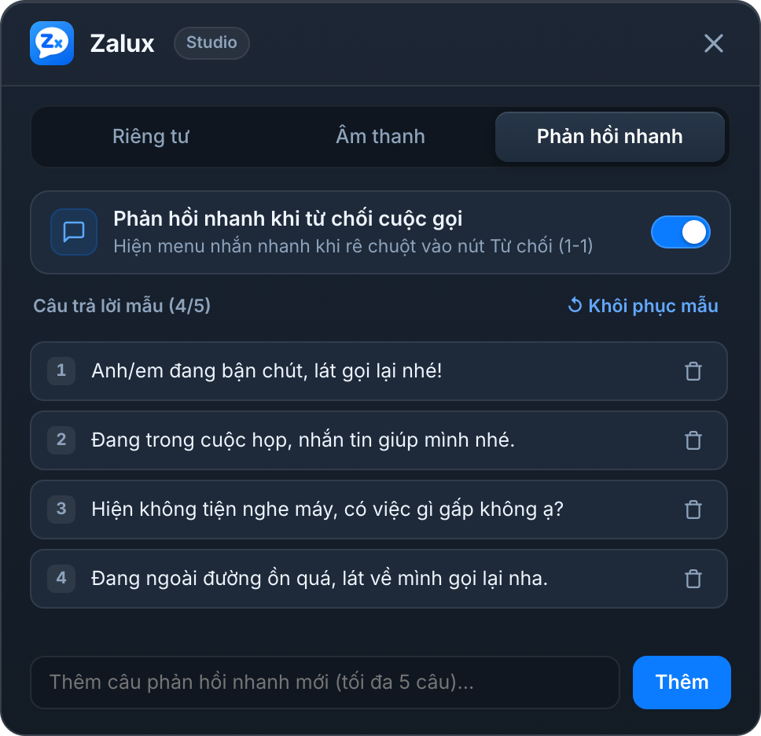

<div align="center">


# Zalux

**Zalo trên Linux — mượt, native, không Wine.**

`Zalo` + `Linux` = `Zalux`

[](LICENSE)
[](#môi-trường-đã-kiểm-thử)
[](VERSION)
[](#hiệu-năng-rust--tài-nguyên-thực-tế)
[](https://todo-laterx.github.io/zalux/)

<sub>Unofficial Zalo desktop for Linux. Independent client powered by an in-house Rust VoIP/SFU Call Engine &amp; 9 Linux N-API native modules.</sub>

</div>

## Giới thiệu

**Zalux** giữ trọn trải nghiệm Zalo quen thuộc bạn dùng mỗi ngày trên Linux, kết hợp cùng **nhân gọi thoại, video nhóm và 9 module hệ thống được viết mới hoàn toàn từ đầu bằng Rust (`zcall-engine`, `zalo-asar` và 9 N-API `.node` addons)**.

> **Kiến trúc Rust Độc lập (Clean-Room):** Toàn bộ hệ thống xử lý cuộc gọi 1:1 & họp nhóm (`zcall-engine`), chia sẻ màn hình `PipeWire`/`OpenH264`, trình đóng gói `zalo-asar`, 9 thư viện `.node` biên dịch riêng cho Linux và bộ giao diện `plugins/{zcall,zalux}` đều được tự thiết kế từ đầu — giúp ứng dụng vận hành mượt mà, ổn định và không cần qua lớp giả lập Wine.

---

## Hệ thống Gọi Thoại, Video 1:1 HD & Họp Nhóm Zavi SFU

<p align="center">
  
</p>

<table>
  <tr>
    <td width="50%" align="center">
      <br>
      <sub><b>Gọi Video 1:1 HD 720p @ 24fps</b> — Nền mờ đồng bộ khung hình, PiP hai chiều &amp; đo mức micro thời gian thực</sub>
    </td>
    <td width="50%" align="center">
      <br>
      <sub><b>Họp Nhóm Zavi SFU (Chế độ Lưới)</b> — Tự khớp khung hình ngang/dọc từng người &amp; viền xanh người đang nói</sub>
    </td>
  </tr>
  <tr>
    <td width="50%" align="center">
      <br>
      <sub><b>Chế độ Người nói (Speaker View)</b> — Phân trang tự động, quản lý phòng &amp; mời thêm bạn ngay trong cuộc gọi</sub>
    </td>
    <td width="50%" align="center">
      <br>
      <sub><b>Chia sẻ màn hình Đa màn hình</b> — Portal PipeWire + OpenH264 native kèm hộp chọn màn hình/cửa sổ trực quan</sub>
    </td>
  </tr>
</table>

---

## Kiến trúc & Cải tiến Kỹ thuật

1. **Rust ZRTC 1:1 & Zavi SFU Group Call Engine (`zcall-engine`)**:
   - Đảm nhiệm trọn vẹn kết nối gọi 1:1 và gọi nhóm Zavi, bảo mật luồng truyền bằng mã hoá SRTP hai chiều và thu phát âm thanh Opus 16 kHz trong trẻo qua `PipeWire` / `PulseAudio`.
   - **Video 1:1 HD sắc nét**: Truyền hình ảnh `1280×720 @ 24fps`, giải mã trực tiếp cả **H.264** lẫn **HEVC** không độ trễ và tự động kết nối lại camera khi thiết bị gián đoạn.
   - **Họp Nhóm Kiểu Zoom**: Chuyển đổi mượt giữa **Chế độ Lưới (`Gallery`)** và **Người nói (`Speaker View`)**, ghim người nói, tự khớp tỉ lệ khung hình riêng (camera PC `16:9` đi cùng điện thoại dọc `9:16` không biến dạng), phân trang khi đông người, xem danh sách thành viên và mời thêm bạn trực tiếp vào phòng.
   - **Chia sẻ màn hình mượt trên cả Wayland & X11**: Kết hợp `PipeWire` và bộ mã hoá `OpenH264` chạy độc lập trong Rust (không phụ thuộc card đồ hoạ rời), đi kèm hộp chọn màn hình/cửa sổ có ảnh xem trước trực quan.
   - **Điều khiển thiết bị thông minh**: Thanh trượt chỉnh âm lượng micro trực tiếp, tự lọc bỏ thiết bị âm thanh ảo và camera hồng ngoại (IR), đồng thời hỗ trợ chủ động nhận cuộc gọi video ở chế độ tắt sẵn camera.
2. **9 Module Native N-API bằng Rust (`runtime/nativelibs/`)**:
   - Toàn bộ 9 thư viện hệ thống đều được viết mới bằng Rust và biên dịch trực tiếp cho Linux `x86_64`: `node_sqlite3` (cơ sở dữ liệu tin nhắn & tìm kiếm nhanh FTS5), `db-cross-v4` (giải mã & đồng bộ lịch sử trò chuyện giữa các thiết bị), `zjxl` (hiển thị ảnh JPEG XL), `zimage`, `mp4thumb` (tạo ảnh thu nhỏ video), `file-utils`, `file-utilities`, `zwalker` (quét & dọn dẹp bộ nhớ đệm) và `zlang` (nhận diện ngôn ngữ).
3. **Tích hợp Sâu Môi trường Desktop Linux**:
   - **System Tray & Thanh Dock**: Biểu tượng khay hệ thống và thanh Dock hiển thị trực tiếp số tin nhắn chưa đọc theo thời gian thực (`zalux.desktop`).
   - **Tương thích GNOME / KDE (Wayland & X11)**: Tự động đồng bộ viền cửa sổ tối theo giao diện hệ thống (`_GTK_THEME_VARIANT=dark`), dán ảnh/tệp nhanh từ clipboard qua `wl-paste` / `xclip` và vận hành ổn định trên cả XWayland lẫn Wayland thuần (`--wayland`).
4. **Bảng điều khiển Zalux Studio (Quyền riêng tư, Âm thanh & Phản hồi nhanh khi bận)**:
   - Mở nhanh từ thanh điều hướng trái hoặc phím tắt `Ctrl+Shift+P` với 3 thẻ trực quan:
     - **Riêng tư**: Toàn quyền kiểm soát trạng thái **“Đang soạn tin”**, **“Đã nhận”** và **“Đã xem”** (chặn tín hiệu ngay trên máy bạn trước khi gửi đi).
     - **Âm thanh**: Kho **12 nhạc chuông cuộc gọi** và **14 âm báo tin nhắn** tinh gọn; nghe thử trực tiếp với hiệu ứng sóng nhạc sống động và đổi âm báo chỉ với một cú nhấp.
     - **Phản hồi nhanh**: Tuỳ biến sẵn tối đa 5 câu trả lời mẫu; khi đang họp hoặc không tiện nghe máy, chỉ cần rê chuột vào nút **Từ chối ▴** để chọn lời nhắn — cuộc gọi được từ chối lịch sự và tin nhắn tự động gửi ngay vào khung chat của người gọi.

---

## Hiệu năng Rust & Tài nguyên Thực tế

Việc viết mới toàn bộ Call Engine và 9 thư viện hệ thống bằng **Rust** giúp loại bỏ hoàn toàn ứng dụng phụ `ZaloHelper.app / ZaloCall` (C++ / Qt5 Widgets + Multimedia nặng nề trên macOS/Windows) cũng như tránh lớp dịch Wine tốn kém trên Linux.

Dưới đây là số liệu đo thực tế qua `/proc/<pid>/smaps_rollup` trên Ubuntu khi đăng nhập tài khoản có lịch sử trò chuyện lớn và mở dùng liên tục:

| Thành phần | Bản gốc (macOS/Windows) hoặc chạy qua Wine | Zalux trên Linux (Native Rust) |
|---|---|---|
| **Daemon Call Engine chạy nền (`idle`)** | `ZaloCall` C++/Qt5: **~80 – 150 MB RSS** | `zcall-engine` (Rust thuần, không GUI runtime): **~3.4 MB PSS** (~5.8 MB RSS) |
| **Giải mã Video H.264/HEVC trực tiếp** | Phụ thuộc tiến trình giao diện phụ nặng nề | `zcall-engine --decode-pipe`: **~6.0 MB PSS** (~12.0 MB RSS, độ trễ 0 frame) |
| **Bộ 9 thư viện Native N-API (`.node`)** | Nhiều dynamic library + framework rời | **~15.4 MB** tổng dung lượng trên đĩa sau khi `strip`, chạy in-process không GC pause |
| **Tổng RAM toàn ứng dụng khi mở nhiều DB chat** | ~650 – 950 MB (+ **300 – 500 MB** nếu chạy qua Wine) | **~788 MB PSS** tổng cộng — trong đó Electron/Chromium + Zalo React UI chiếm **~778 MB PSS (~98.8%)**, toàn bộ tầng Rust của Zalux chỉ chiếm **< 1.2% (~3.4 – 9.4 MB PSS)** |

> **Số liệu thực tế minh bạch:** Phần lớn bộ nhớ thuộc về giao diện web Electron của Zalo (~778 MB PSS khi mở nhiều cuộc trò chuyện lớn). Nhờ viết bằng Rust, toàn bộ nhân xử lý cuộc gọi thoại/video/nhóm, chia sẻ màn hình PipeWire và 9 module hệ thống của Zalux chỉ chiếm chưa tới 1.2% RAM — không rò rỉ bộ nhớ khi mở máy suốt ngày dài và không kéo theo bất kỳ tiến trình phụ nặng nề nào.

---

## Môi trường đã kiểm thử

| Bản phân phối | Nhắn tin / Đồng bộ / Media | Gọi 1:1 · Gọi Nhóm · Share Màn hình | Ghi chú |
|---|---|---|---|
| **Ubuntu 26.04 / 24.04** | Đã kiểm thử | Voice · Video HD · Group SFU · PipeWire | GNOME Wayland (XWayland) & X11 |
| **Debian 12 / 13** | Tương thích | Tương thích | AppImage / `.deb` |
| **Fedora / RHEL** | Tương thích | Tương thích | AppImage / `.rpm` (`pipewire-libs`) |
| **Arch Linux** | Tương thích | Tương thích | AppImage / `PKGBUILD` (`libpipewire`) |

---

## Cài đặt

### Cách 1: Cài nhanh một dòng lệnh (không cần quyền root)

```bash
curl -fsSL https://raw.githubusercontent.com/todo-laterx/zalux/main/scripts/bootstrap.sh | bash
```

### Cách 2: Clone kho mã & cài bản phát hành mới nhất

```bash
git clone https://github.com/todo-laterx/zalux.git
cd zalux
./scripts/install-latest.sh
# Hoặc cài từ file AppImage / thư mục AppDir đã build sẵn:
./installer/install.sh /path/to/Zalux-26.10.20-x86_64.AppImage
~/.local/bin/zalux
```

### Cách 3: Tự đóng gói sạch trực tiếp từ file DMG gốc của Zalo

Repo **không chứa bộ cài `.dmg` hay gói `app.asar` độc quyền của Zalo**. Bạn có thể tự tái tạo gói cài đặt từ file DMG tải từ trang chủ Zalo chỉ với `7z`, `python3`, `curl`, `unzip` (không cần cài Node.js hay trình biên dịch Rust):

```bash
./scripts/build-from-dmg.sh 26.10.20
# Kết quả: dist/Zalux-26.10.20-x86_64.AppImage và build/AppDir
./installer/install.sh build/AppDir
```

### Cách 4: Đóng gói hệ thống (`.deb` / `.rpm`)

```bash
# Debian / Ubuntu
packaging/deb/build.sh build/AppDir 26.10.20
sudo apt install ./dist/zalux_26.10.20_amd64.deb

# Fedora / RHEL (cần rpm-build)
packaging/rpm/build.sh dist/Zalux-26.10.20-x86_64.AppImage 26.10.20
sudo dnf install ./dist/zalux-26.10.20-1.x86_64.rpm
```

Xem chi tiết gói thư viện hệ thống (`libopus`, `libpipewire`, `xdg-desktop-portal`, `ffmpeg`...) tại [docs/DEPENDENCIES.md](docs/DEPENDENCIES.md) và quy trình đóng gói tại [docs/PACKAGING.md](docs/PACKAGING.md).

---

## Cấu trúc dự án

```text
zalux/
├── runtime/          Prebuilt Rust binaries (zcall-engine, zalo-asar, 9 N-API .node) + open-source plugins/{zcall,zalux} & toolchain
├── installer/        install.sh, zalux-run, zalux.desktop
├── packaging/        Kịch bản đóng gói deb, rpm, AUR, Flatpak
├── scripts/          build-from-dmg, bootstrap, install-latest, update, check-update, uninstall
├── docs/             Tài liệu phụ thuộc hệ thống & quy trình đóng gói
├── assets/           Biểu tượng Zalux & bộ ảnh/GIF thực tế giao diện Call + Cài đặt
├── site/             Trang web giới thiệu (GitHub Pages)
└── README.md  LICENSE  NOTICE  TRADEMARK.md  SECURITY.md  CHANGELOG.md  VERSION
```

## Cửa sổ Cuộc gọi đến & Bảng Cài đặt Zalux Studio

<table>
  <tr>
    <td width="50%" align="center" valign="middle">
      <br>
      <sub><b>Cuộc gọi đến &amp; Phản hồi nhanh</b> — Nhận cuộc gọi tắt sẵn camera hoặc rê chuột vào <b>Từ chối ▴</b> để gửi lời nhắn nhanh khi đang bận</sub>
    </td>
    <td width="50%" align="center" valign="middle">
      <br>
      <sub><b>Zalux Studio · Riêng tư</b> — Chủ động ẩn trạng thái đang soạn tin, đã nhận và đã xem</sub>
    </td>
  </tr>
  <tr>
    <td width="50%" align="center" valign="middle">
      <br>
      <sub><b>Zalux Studio · Âm thanh</b> — 12 nhạc chuông &amp; 14 âm báo tin nhắn kèm hiệu ứng sóng nhạc nghe thử trực tiếp</sub>
    </td>
    <td width="50%" align="center" valign="middle">
      <br>
      <sub><b>Zalux Studio · Phản hồi nhanh</b> — Tuỳ biến sẵn các câu trả lời lịch sự tự động gửi khi từ chối cuộc gọi</sub>
    </td>
  </tr>
</table>

## Pháp lý & Bản quyền

- **Zalo** và các nhãn hiệu liên quan thuộc quyền sở hữu của VNG Corporation / Zalo.
- **Zalux** là dự án kỹ thuật độc lập phục vụ tương thích hệ điều hành Linux; không liên kết, không được tài trợ hay chứng thực bởi Zalo / VNG.
- Toàn bộ hệ thống của Zalux được tự phát triển độc lập (100% clean-room), không phụ thuộc bất kỳ dự án cộng đồng bên thứ ba nào: tầng tích hợp giao diện (`runtime/plugins/`), bộ công cụ đóng gói (`runtime/toolchain/`, `scripts/`, `installer/`, `packaging/`) mở mã nguồn theo giấy phép **MIT**; bộ nhân thực thi Rust (`zcall-engine`, `zalo-asar` và 9 module N-API `.node` trong `runtime/`) được phân phối dưới dạng **Prebuilt Native Rust Binaries** biên dịch sẵn cho Linux `x86_64` nhằm bảo toàn tính toàn vẹn giao thức (xem [LICENSE](LICENSE) và [NOTICE](NOTICE)).
- Kho mã nguồn này không lưu trữ tệp `.dmg` hay `.asar` của Zalo trong cây mã nguồn. Các mẫu âm thanh thông báo & nhạc chuông bổ sung đi kèm thuộc giấy phép [Mixkit Free License](https://mixkit.co/license/).
