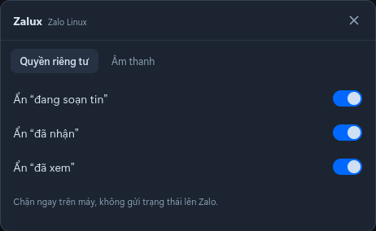
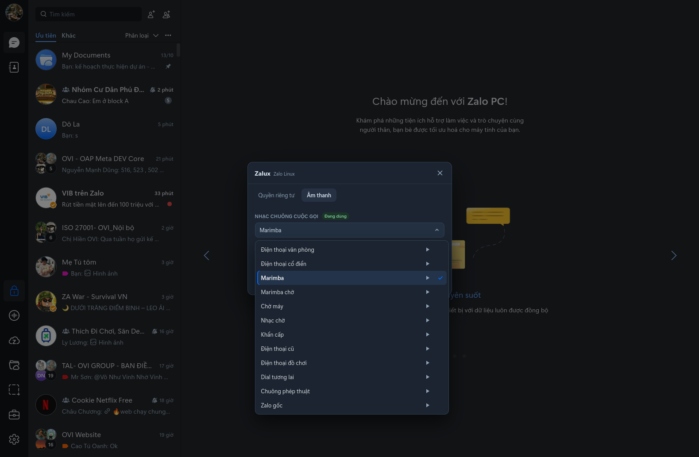

<div align="center">

# Zalux

**Zalo trên Linux — mượt, native, không Wine.**

`Zalo` + `Linux` = `Zalux`

[](LICENSE)
[](#môi-trường-đã-test)
[](VERSION)
[](https://todo-laterx.github.io/zalux/)

<sub>Unofficial Zalo desktop for Linux. Official macOS client, native call engine, no Wine.</sub>

</div>

## Vì sao có Zalux?

Linux là nơi mình làm việc mỗi ngày. Nhưng Zalo — thứ gần như không thể thiếu để giữ liên lạc với
gia đình, bạn bè và công việc — lại không có bản Linux chính thức.

Zalo Web dùng được nhưng thiếu gọi điện, thông báo chậm và nhiều thứ nhỏ nhặt cứ làm mình vướng.
Chạy bản Windows qua Wine thì được, nhưng nặng, dễ giật và gọi điện hay lỗi. Mình muốn một thứ đơn giản
hơn: mở lên, đăng nhập, nhắn tin, gọi điện, rồi tiếp tục công việc — không phải nghĩ về “chạy bằng gì”.

Zalux ra đời từ ý tưởng đó: **lấy chính client Zalo macOS chính thức, chuyển sang chạy native trên
Linux Electron**, thay phần native macOS bằng thư viện Linux, và bổ sung một lớp patch nhỏ để cuộc sống
trên Linux dễ chịu hơn. Không viết lại Zalo. Không Wine. Không giả lập.

Mục tiêu không phải là một “bản mod” thật nhiều tính năng, mà là một bản Zalo **đủ tốt để dùng hằng ngày**,
đủ nhẹ để không phải nghĩ tới, và đủ mở để cộng đồng cùng sửa khi Zalo ra bản mới.

## Ý nghĩa tên Zalux

- **Zal** — Zalo.
- **ux** — Linux (đuôi quen thuộc của Linux/Unix).
- **lux** — ánh sáng.

Đọc liền thành **Zalux**: Zalo trên Linux, nhẹ và rõ hơn — như mang nó ra khỏi màn hình tối của Wine.

## Vì sao không dùng Web/Wine?

| | Zalo Web | Zalo qua Wine | Zalux |
|---|---|---|---|
| Giao diện | Bản web, thiếu nhiều tính năng desktop | Gần đủ nhưng nặng | UI/UX macOS gốc |
| Gọi điện | Không có | Chập chờn, helper Windows | Native `zcall-native`, không Wine |
| Hiệu năng | Phụ thuộc trình duyệt | Giật, RAM cao | Electron 22 + patch Linux |
| Cài đặt | Mở trình duyệt | Wine + thủ công | AppImage / deb / rpm, một lệnh |
| Cập nhật | Theo web | Theo bản Windows | Script update + patch tự động |

## Tính năng nổi bật

- **Đúng UI/UX Zalo macOS**: chat, file, ảnh, sticker, reaction, ghim, nhắc hẹn — giữ nguyên trải nghiệm gốc.
- **Gọi điện native**: voice, video và gọi nhóm qua `zcall-native` + PulseAudio/Opus; **không Wine**, không helper Windows.
- **ZaSetup trong sidebar**: bật/tắt ẩn “đang soạn tin”, “đã nhận”, “đã xem”.
- **Âm thanh phong phú**: 12 nhạc chuông và 14 âm thông báo; nghe thử play/pause từng mẫu, chọn là áp dụng ngay.
- **Những chi tiết nhỏ**: cuộc gọi đến căn giữa màn hình, lọc camera IR (tránh đen trắng/nháy hồng ngoại),
  ẩn titlebar thừa, bỏ tên tài khoản trên thanh tiêu đề.
- **Tự patch sau update**: AppImage mới được tách, áp patch và cài lại bằng một lệnh.
- **Đóng gói linh hoạt**: AppImage, script cài không cần root, script build `.deb` và `.rpm`.
- **Không telemetry, không tài khoản trung gian**: dữ liệu vẫn nằm trong `~/.config/ZaloData` như bản gốc.

## Môi trường đã test

- Ubuntu 26.04, GNOME Wayland + X11, Electron 22.3.27.
- Zalo 26.10.20 (macOS client), `zcall-native`.
- **Call điện thoại, call video và call nhóm đã test trên Ubuntu 26.04** (voice/video, có/không camera).
- Chat, file, ảnh, sticker, reaction, ghim; ZaSetup; đổi chuông/thông báo.
- Không test: ARM64, KDE/Fedora runtime, OCR (bản build bỏ OCR vì cần Windows installer).

## Tương thích

| Distro | Chat / UI | Call | Ghi chú |
|---|---|---|---|
| Ubuntu 26.04 | Đã test | Voice · Video · Group | Wayland + X11 |
| Ubuntu 24.04 | Dự kiến | Chưa test | Dùng gói t64 |
| Debian 12 / 13 | Dự kiến | Chưa test | AppImage + installer |
| Fedora / RHEL | Dự kiến | Chưa test | Cần rpm-build |
| Arch Linux | Dự kiến | Chưa test | Chưa có AUR |

## Giới hạn đã biết

- Phụ thuộc upstream cho phần chuyển đổi macOS → Linux; Zalo đổi internals có thể làm patch vỡ.
- Bản build hiện **bỏ OCR** và **ZaDark** (Zalo đã có dark mode sẵn).
- `.rpm` cần `rpmbuild` khi build; chưa test trên Fedora thật.
- Ẩn trạng thái hoạt động bằng chặn request; Zalo đổi endpoint cần cập nhật regex.
- Không phải sản phẩm chính thức của Zalo/VNG.

## Cài đặt

### Cách 0: một dòng lệnh (không cần root)

```bash
curl -fsSL https://raw.githubusercontent.com/todo-laterx/zalux/main/scripts/bootstrap.sh | bash
```

Script tải repo, tải **AppImage Original từ upstream VN-Linux-Family** (không phải binary nằm trong repo này), áp patch, cài vào `~/.local` và tạo desktop entry.
Installer chỉ cần `python3`, `curl`, `git` — **không cần Node/npm**; patch `app.asar` dùng `patches/asar.py`.

Nếu muốn dùng AppImage của riêng bạn (ví dụ tự build từ DMG official):
```bash
ZALUX_APPIMAGE_URL=/path/to/Zalo.AppImage ./scripts/install-latest.sh
# hoặc
./scripts/install-latest.sh /path/to/Zalo.AppImage
```
Repo không chứa/chia sẻ binary Zalo; xem `scripts/build-from-dmg.sh` để build từ DMG official.

### Cách 1: clone + installer

```bash
git clone https://github.com/todo-laterx/zalux.git
cd zalux
./scripts/install-latest.sh
# hoặc chỉ định AppImage có sẵn:
./installer/install.sh /path/to/Zalo-<version>-Original-x86_64.AppImage
~/.local/bin/zalux
```

### Cách 2: gói hệ thống

Tải `.deb` đóng gói sẵn từ [Releases](https://github.com/todo-laterx/zalux/releases/tag/26.10.20)
hoặc build tại máy:

```bash
# Debian/Ubuntu
packaging/deb/build.sh /path/to/Zalo.AppImage 26.10.20
sudo apt install ./dist/zalux_26.10.20_amd64.deb

# Fedora/RHEL (cần rpm-build)
packaging/rpm/build.sh /path/to/Zalo.AppImage 26.10.20
sudo dnf install ./dist/zalux-26.10.20-1.x86_64.rpm
```

Xem [docs/DEPENDENCIES.md](docs/DEPENDENCIES.md) để biết gói cần cài và
[docs/PACKAGING.md](docs/PACKAGING.md) cho chi tiết đóng gói.

## Cập nhật khi Zalo ra bản mới

```bash
./scripts/check-update.sh      # so sánh DMG official / AppImage upstream / bản đang cài
./scripts/update.sh            # tải bản mới + patch + cài
./scripts/build-from-dmg.sh 26.x.y   # khi upstream chưa có bản tương ứng
```

Mỗi bản update đều được áp lại bộ patch trong `patches/`; dữ liệu đăng nhập và tin nhắn không bị đụng tới.

## Cấu trúc dự án

```text
zalux/
├── installer/        install.sh, wrapper, desktop entry
├── patches/          asar/preload/main patches, ZaSetup, sounds, apply.sh
├── packaging/        deb + rpm + AUR + Flatpak
├── scripts/          bootstrap, install-latest, update, check-update, build-from-dmg, uninstall
├── docs/             dependencies, packaging
├── assets/           icon, screenshots, donate QR
├── site/             landing page (GitHub Pages)
├── .github/          CI
├── README.md  LICENSE  NOTICE  TRADEMARK.md  SECURITY.md  CHANGELOG.md
└── VERSION
```

## Website

Landing page nằm trong `site/`; GitHub Actions `pages.yml` deploy lên GitHub Pages khi repo public.
Xem local: mở `site/index.html`.

## Ảnh

<p align="center">
  
  
</p>

## Chia sẻ

Nếu Zalux giúp bạn dùng Zalo trên Linux dễ chịu hơn, hãy chia sẻ repo cho người khác.
Cách tốt nhất để dự án sống lâu là có thêm người dùng, thêm báo lỗi và thêm người thử trên nhiều distro.

Repo **không** chứa binary Zalo, DMG hay AppImage. Người dùng tự tải từ nguồn chính thức/upstream;
script trong repo chỉ lo phần chuyển đổi, patch và đóng gói.

## Ủng hộ

Zalux miễn phí và mã nguồn mở. Nếu bạn thấy hài lòng và muốn mình có thêm thời gian theo các bản
Zalo mới — thử call, sửa lỗi, cập nhật patch — bạn có thể mời mình một ly cà phê.

<p align="center">
  
</p>

<p align="center">
  ACB · NGUYEN THANH TUAN · 117717
</p>

Không bắt buộc. Chỉ cần bạn dùng và thấy nó đỡ vướng là đủ.

## Ghi công & pháp lý

- Toolchain repack: [VN-Linux-Family/zalo-for-linux](https://github.com/VN-Linux-Family/zalo-for-linux) (MIT) — dùng script/nativelibs/zcall-native của upstream để chuyển **DMG macOS official** sang Linux; không dùng AppImage đóng gói sẵn của họ.
- Âm thanh mặc định: Mixkit Free License.
- Zalo, logo và tài sản liên quan thuộc VNG Corporation / Zalo.
- Zalux **không phải** sản phẩm chính thức của Zalo/VNG. Dùng cho mục đích cá nhân;
  không phân phối lại binary Zalo.
- Script và patch trong repo: MIT (xem [LICENSE](LICENSE)).
